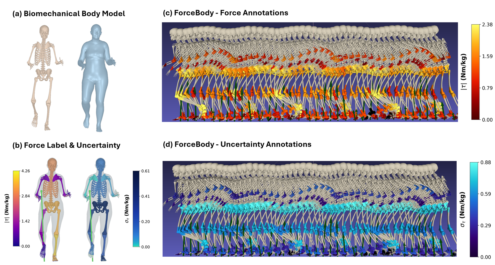
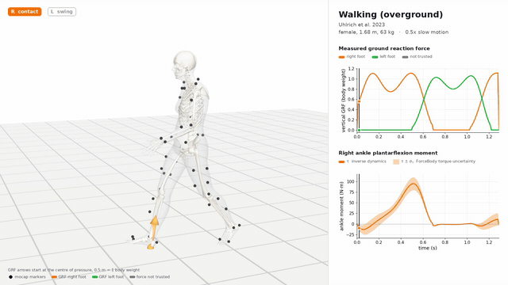
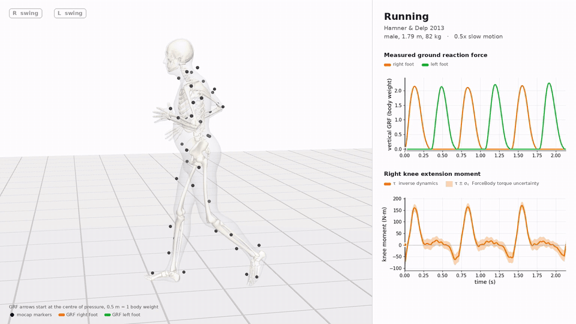
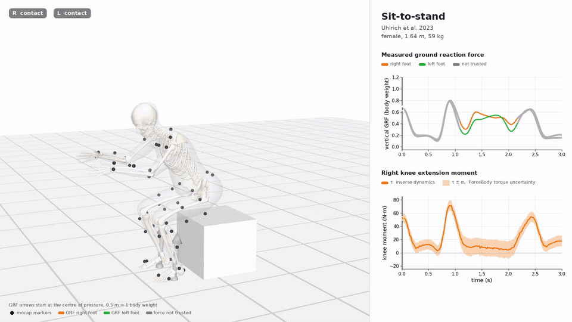
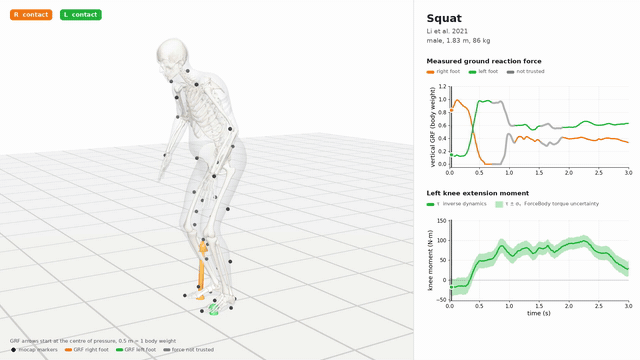
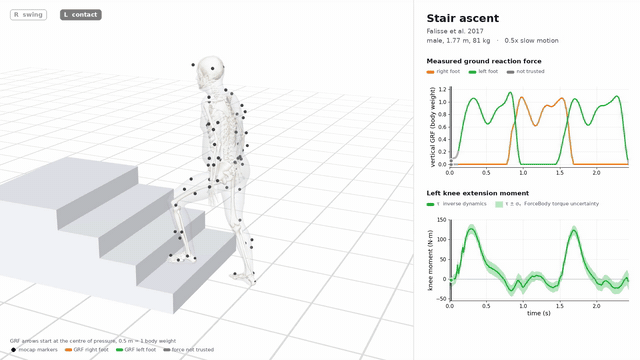
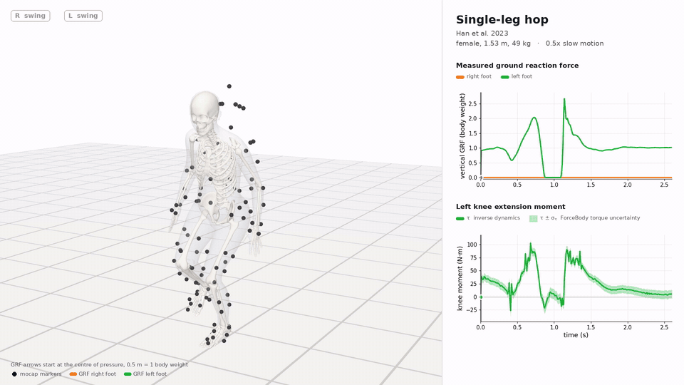
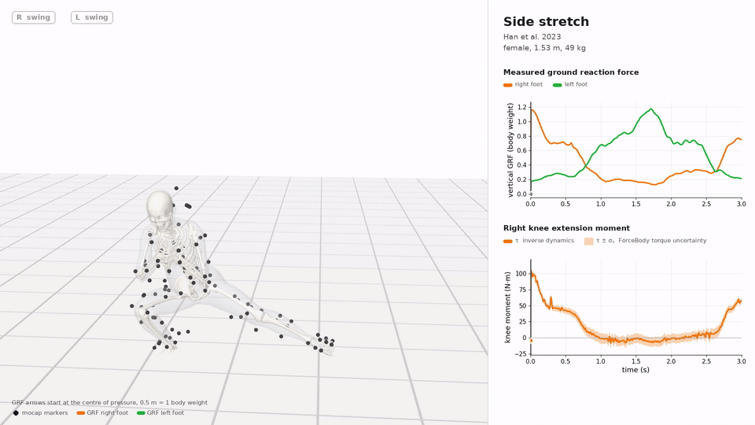
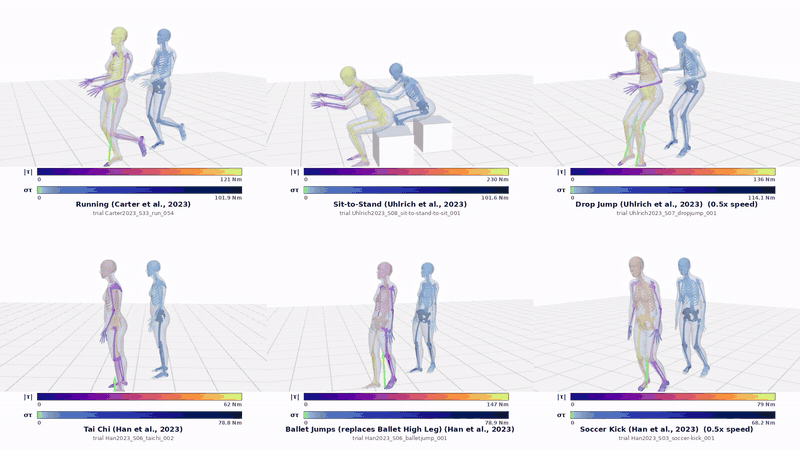
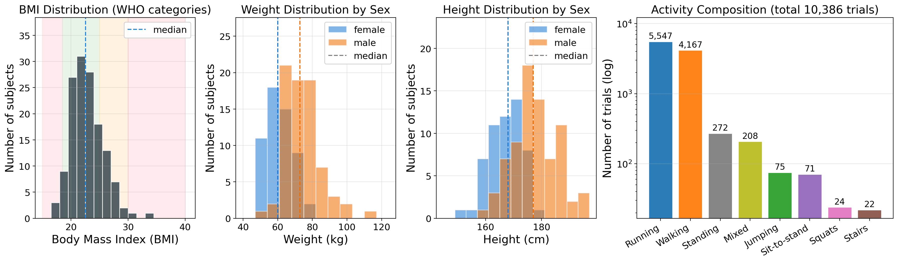

<div align="center">

# ForceBody

### Force-Paired Parametric Body Motion with Torque Uncertainty

**NeurIPS 2026, Evaluations & Datasets Track (poster)**

Joonwoo Kwon, Yufei Zhang, Xiaoming Liu, Zijun Cui

[](#) <!-- TODO: paper link (OpenReview / proceedings) -->
[-yellow.svg)](#) <!-- TODO: Hugging Face dataset link -->
[](LICENSE)
[](https://creativecommons.org/licenses/by-nc/4.0/)



</div>

ForceBody pairs the [SKEL](https://skel.is.tue.mpg.de/) parametric body model with measured ground reaction forces (GRF) and inverse-dynamics joint torques.
Each torque label comes with a per-frame, per-joint uncertainty (σ<sub>τ</sub>) obtained by Monte Carlo sampling through the inverse dynamics pipeline.
The motions come from ten public motion-capture studies in [AddBiomechanics](https://addbiomechanics.org/).
Every trial is one NumPy `.npz` file, so you can read the data with NumPy alone.

> **Data source note.** ForceBody does not contain newly recorded motion capture. It refits existing AddBiomechanics data to SKEL and adds cleaned forces, recomputed torques and torque uncertainty.

## Key numbers

| Trials | Subjects | Duration | Frames | Studies | Torque uncertainty |
|:---:|:---:|:---:|:---:|:---:|:---:|
| 10,386 | 140 | 26.9 h | 9.7 M | 10 | σ<sub>τ</sub> per frame and per joint DOF |

- 140 subjects. 75 male, 55 female, 10 with unreported sex.
- Height 1.73 ± 0.09 m, mass 68.8 ± 11.5 kg.
- About 98% of trials are on a grid near 100 Hz. The others keep their native rate (61, 201 or 250 Hz).
- σ<sub>τ</sub> is released for 10,382 of 10,386 trials.

## Demo gallery

Each clip shows the SKEL body with motion-capture markers and GRF arrows at the centre of pressure.
The right panel shows the measured vertical GRF per foot and one joint moment τ with the band τ ± σ<sub>τ</sub>.

| Walking (Uhlrich2023) | Running (Hamner2013) |
|:---:|:---:|
|  |  |
| **Sit-to-stand (Uhlrich2023)** | **Squat (Li2021)** |
|  |  |
| **Stair ascent (Falisse2017)** | **Single-leg hop (Han2023)** |
|  |  |
| **Side stretch (Han2023)** | |
|  | |

Torque magnitude |τ| (left body in each pair) and torque uncertainty σ<sub>τ</sub> (right body) on six activities.



Higher-quality MP4 versions of every clip are in [`assets/`](assets/).

## What is in each trial

One file per trial, `trials/<study>/S<NN>/<trial_uid>.npz`. The main fields are below. The full list (547 fields with dtype, shape, unit and frame) is in `SCHEMA_v1.3.csv` of the dataset release.

| Field | Shape | Unit | Frame | Content |
|---|---|---|---|---|
| `poses` | [T, 46] | rad | skel_world | SKEL pose fitted to the AddB kinematics pass (never saw the force plates) |
| `trans` | [T, 3] | m | skel_world | SKEL root translation of `poses` |
| `joints` | [T, 24, 3] | m | skel_world | SKEL joint centres of `poses` |
| `betas` | [10] | | | SKEL shape, one per person |
| `skel_gender` | scalar | | | SKEL model used for the fit |
| `poses_dyn`, `trans_dyn`, `joints_dyn` | as above | | skel_world | Second SKEL fit, to the AddB dynamics pass (force-aware) |
| `q_kin`, `q_gt` | [T, 37] | rad, m | addb_lab | AddB kinematics-pass and dynamics-pass joint angles (OpenSim Rajagopal DOFs) |
| `grf_aligned` | [T, C, 3] | N | skel_world | Measured ground reaction force per contact (0 = right foot, 1 = left foot) |
| `cop_aligned_foot` | [T, C, 3] | m | skel_world | Centre of pressure per contact |
| `contact_torque_aligned` | [T, C, 3] | N m | skel_world | Free moment at the centre of pressure |
| `tau_selfconsistent` | [T, 37] | N m, N | addb_lab | Inverse-dynamics joint torque label |
| `mu_tau`, `sigma_tau` | [T, 37] | N m, N | addb_lab | Monte Carlo mean and standard deviation of the torque |
| `grf_frame_ok`, `tau_frame_ok`, `mc_frame_ok` | [T] | | | Frame masks for GRF, torque and σ<sub>τ</sub> use |
| `mass_kg`, `mass_kg_dynamics` | scalar | kg | | Recorded mass (model input) and dynamics mass (label normalization) |
| `fps`, `fps_true_grid` | scalar | Hz | | Nominal and true frame rate |

Trial-level metadata (study, activity, protocol, person, captions and quality flags) is in each file and in `manifest.csv`.

**Read before training.** Masked values are not NaN, so always apply the frame masks. Normalize GRF, torque and σ<sub>τ</sub> by `mass_kg_dynamics` only. A model that predicts forces or torques must take its motion input from the kinematics-pass pose set (`pose_source="pass0"`). The dynamics-pass poses were adjusted by AddBiomechanics to agree with the measured forces, so they leak force information. The dataset README explains the leakage policy, the quality masks and the known issues in detail.

## Quickstart

### 1. Download

```bash
# TODO: replace with the final Hugging Face repository id
huggingface-cli download <TODO-org>/ForceBody --repo-type dataset --local-dir ForceBody
```

The full release is about 74 GB (trials about 37 GB). Get the SKEL model files from the [SKEL authors](https://skel.is.tue.mpg.de/) under their license if you want to build meshes.

### 2. Load a trial

`forcebody_io.py` needs only NumPy.

```python
import forcebody_io as fio

d = fio.load_trial("trials/Moore2015/S10/Moore2015_S10_walk_014.npz", pose_source="pass0")

poses   = d["poses"]               # [T, 46] SKEL pose (rad), kinematics-pass fit
trans   = d["trans"]               # [T, 3]  SKEL root translation (m)
betas   = d["betas"]               # [10]    SKEL shape
grf     = d["grf_aligned"]         # [T, C, 3] GRF (N), SKEL world frame, y up
tau     = d["tau_selfconsistent"]  # [T, 37] joint torque (N m), OpenSim DOF order
sigma   = d["sigma_tau"]           # [T, 37] torque uncertainty (N m)
m       = float(d["mass_kg_dynamics"])

ok = d["mc_frame_ok"]              # frames where tau and sigma_tau are usable
tau_nmkg, sigma_nmkg = tau[ok] / m, sigma[ok] / m
```

`pose_source` is required. Use `"pass0"` (alias `"kin"`) for force and torque estimation, and `"pass2"` (alias `"dyn"`) for motion generation with force labels. `load_trial` maps the chosen set to the common keys `poses`, `trans`, `joints`, `q`, `qd`, `qdd`, `addb_joints` and adds `pose_usable` and `pose_source`. `fio.ALLOWED_INPUT_FIELDS` and `fio.LEAKY_INPUT_FIELDS` list the allowed and refused model inputs.

### 3. Visualize

```bash
python visualize.py --npz trials/Moore2015/S10/Moore2015_S10_walk_014.npz --mode png --pose_source pass0
python visualize.py --npz trials/Moore2015/S10/Moore2015_S10_walk_014.npz --mode mp4 --pose_source pass2
```

Options are `--out`, `--fps` (default 20) and `--max-frames` (default 150). The renderer draws the SKEL body coloured by `tau_selfconsistent` and GRF arrows at the centre of pressure.
`visualize.py` needs the SKEL model files, an EGL renderer and the addb2skel rendering utilities. **TODO.** The addb2skel package is not yet public, so `visualize.py` does not run from a clean checkout. Reading the data does not need it.

## Benchmark

Two tasks predict forces from SKEL motion. T-τ predicts joint torques and T-GRF predicts per-foot ground reaction forces. Results below are the camera-ready numbers.

**Protocol.** Dataset release 1.2.1 (benchmark data identical in 1.3.0 except 40 renamed Hamner2013 keys). Person-level split with 8,374 train, 1,098 val and 914 test trials. Inputs come from the kinematics-pass fit only. Checkpoints are selected on val and the test split is scored once. Mean ± standard deviation over three seeds. 20 scored DOFs on 14 joints. R = RMSE (N m/kg), M = MAE (N m/kg), P = Pearson correlation.

### Joint torque prediction (paper Table 4)

| Model | Upper R ↓ | Upper M ↓ | Upper P ↑ | Lower R ↓ | Lower M ↓ | Lower P ↑ | All R ↓ | All M ↓ | All P ↑ |
|---|---|---|---|---|---|---|---|---|---|
| MLP | 0.008 ± 0.000 | 0.004 ± 0.000 | 0.644 ± 0.002 | 0.241 ± 0.006 | 0.168 ± 0.004 | 0.833 ± 0.003 | 0.148 ± 0.003 | 0.103 ± 0.002 | 0.757 ± 0.002 |
| Conv1D | 0.007 ± 0.000 | 0.004 ± 0.000 | 0.700 ± 0.003 | 0.210 ± 0.003 | 0.141 ± 0.002 | 0.870 ± 0.003 | 0.129 ± 0.002 | 0.086 ± 0.001 | 0.802 ± 0.002 |
| LSTM | 0.007 ± 0.000 | 0.004 ± 0.000 | 0.691 ± 0.004 | 0.214 ± 0.004 | 0.145 ± 0.002 | 0.864 ± 0.003 | 0.131 ± 0.002 | 0.088 ± 0.001 | 0.795 ± 0.003 |
| GRU | 0.007 ± 0.000 | 0.003 ± 0.000 | 0.701 ± 0.009 | 0.207 ± 0.002 | 0.139 ± 0.002 | 0.875 ± 0.002 | 0.127 ± 0.001 | 0.085 ± 0.001 | 0.805 ± 0.003 |
| **Mamba2** | 0.007 ± 0.000 | 0.003 ± 0.000 | **0.714 ± 0.005** | **0.204 ± 0.002** | **0.134 ± 0.002** | **0.878 ± 0.004** | **0.125 ± 0.001** | **0.082 ± 0.001** | **0.813 ± 0.004** |
| Transformer | 0.008 ± 0.000 | 0.005 ± 0.000 | 0.651 ± 0.014 | 0.253 ± 0.015 | 0.176 ± 0.011 | 0.833 ± 0.007 | 0.155 ± 0.009 | 0.107 ± 0.007 | 0.760 ± 0.010 |

Upper = elbow, radioulnar, wrist. Lower = hip, knee, ankle, MTP.

### Uncertainty-weighted training (paper Table 5)

The same Transformer is fine-tuned with one loss weight per training window computed from its mean σ<sub>τ</sub>. Nothing else changes.

| All joints | R ↓ | M ↓ | P ↑ |
|---|---|---|---|
| Transformer | 0.155 ± 0.009 | 0.107 ± 0.007 | 0.760 ± 0.010 |
| Transformer + UW | 0.149 ± 0.007 (−4%) | 0.101 ± 0.007 (−5%) | 0.772 ± 0.012 (+2%) |

### Ground reaction force prediction (paper Table 3)

| Dataset | Body model | Architecture | GRF (N/kg) ↓ | GRM (N m/kg) ↓ |
|---|---|---|---|---|
| AddBiomechanics | Rajagopal | MLP | 2.091 | 0.278 |
| AddBiomechanics | Rajagopal | GLN | 1.712 | 0.275 |
| ForceBody | SKEL | MLP | 1.165 ± 0.011 | 0.168 ± 0.009 |
| ForceBody | SKEL | GLN | 1.136 ± 0.040 | 0.149 ± 0.011 |

The AddBiomechanics rows are copied from paper Table 3 and use the Rajagopal body model. The comparison is architecture-matched. GRM values for ForceBody are not part of the official benchmark scorer. <!-- TODO: state the exact origin of the AddB rows (AddB paper values or our rerun) as the paper does. -->

The benchmark card (`benchmark/BENCHMARK.md`), the machine-readable spec (`benchmark/spec_v12.json`), the cache builder and the reference scorer ship with the dataset release. BENCHMARK.md reports single-seed rows with person-level bootstrap intervals on the healthy test stratum, so its numbers differ slightly from the three-seed table above.

## Dataset composition



| Study | Trials | Subjects | M / F / U | Height (m) | Mass (kg) | Main activity |
|---|---:|---:|---|---|---|---|
| Carter2023 | 7,006 | 50 | 25 / 25 / 0 | 1.73 ± 0.08 | 65.8 ± 10.6 | running, walking |
| vanderZee2022 | 1,089 | 10 | 0 / 0 / 10 | 1.76 ± 0.11 | 73.5 ± 15.0 | walking |
| Moore2015 | 1,019 | 12 | 8 / 4 / 0 | 1.73 ± 0.09 | 71.4 ± 11.9 | walking |
| Tiziana2019 | 619 | 25 | 14 / 11 / 0 | 1.71 ± 0.11 | 69.6 ± 14.2 | walking |
| Han2023 | 240 | 7 | 3 / 4 / 0 | 1.72 ± 0.14 | 66.4 ± 13.6 | mixed |
| Uhlrich2023 | 160 | 10 | 4 / 6 / 0 | 1.74 ± 0.12 | 69.2 ± 11.6 | walking, jumping |
| Fregly2012 | 78 | 4 | 3 / 1 / 0 | 1.71 ± 0.06 | 71.3 ± 6.5 | walking |
| Falisse2017 | 70 | 11 | 7 / 4 / 0 | 1.76 ± 0.06 | 70.0 ± 6.4 | sit-to-stand, walking |
| Li2021 | 65 | 1 | 1 / 0 / 0 | 1.83 | 85.7 | walking |
| Hamner2013 | 40 | 10 | 10 / 0 / 0 | 1.74 ± 0.05 | 71.6 ± 6.3 | running |
| **Total** | **10,386** | **140** | **75 / 55 / 10** | 1.73 ± 0.09 | 68.8 ± 11.5 | |

| Activity | Running | Walking | Standing | Mixed | Jumping | Sit-to-stand | Squats | Stairs |
|---|---:|---:|---:|---:|---:|---:|---:|---:|
| Trials | 5,547 | 4,167 | 272 | 208 | 75 | 71 | 24 | 22 |

The data are imbalanced. Running and walking make up 93.5% of the trials, and Carter2023 contributes 67.5%. Results on rare activities rest on few trials. The vanderZee2022 subjects have unreported sex, and their SKEL model is chosen by height. The data include one stroke subject (Li2021) and four subjects after total knee arthroplasty (Fregly2012). These are reported as a separate stratum.

## Repository contents

| Path | Status |
|---|---|
| `README.md`, `LICENSE`, `assets/` | this page |
| `forcebody_io.py` | data loader (also shipped with the dataset release) |
| `visualize.py`, `VISUALIZATION.md` | renderer (needs addb2skel, not yet public) |
| `benchmark/` | benchmark card, spec, cache builder, reference scorer |
| Baseline training code (torque models, GRF models, uncertainty weighting) | **TODO.** Not yet in this repository. It is being cleaned for release |
| SKEL fitting pipeline (addb2skel) | **TODO.** Not yet in this repository |

<!-- TODO: update this table to match the files actually pushed. -->

## License

- **Code** in this repository is released under the [MIT license](LICENSE).
- **Data** are released under [CC BY-NC 4.0](https://creativecommons.org/licenses/by-nc/4.0/). Commercial use is not permitted.
- Fields derived from AddBiomechanics (forces, AddB kinematics, torques, uncertainty, metadata) build on the AddBiomechanics dataset (CC BY 4.0). Cite AddBiomechanics and every source study you use.
- SKEL-derived fields (`poses*`, `trans*`, `joints*`, `betas`, `skel_gender`) are also subject to the [SKEL model license](https://skel.is.tue.mpg.de/), which allows non-commercial scientific research only. Building meshes from these fields requires the SKEL model, which you obtain from its authors.
- The data include health information (stroke, total knee arthroplasty). Do not attempt to re-identify persons. ForceBody is not intended for clinical decisions.

## Citation

```bibtex
@inproceedings{kwon2026forcebody,
  title     = {ForceBody: Force-Paired Parametric Body Motion with Torque Uncertainty},
  author    = {Kwon, Joonwoo and Zhang, Yufei and Liu, Xiaoming and Cui, Zijun},
  booktitle = {Advances in Neural Information Processing Systems (NeurIPS), Evaluations and Datasets Track},
  year      = {2026}
}
```

<!-- TODO: add pages / url / OpenReview id once the proceedings are out. -->

Please also cite AddBiomechanics, SKEL and the source studies you use.

```bibtex
@inproceedings{werling2024addbiomechanics,
  title     = {AddBiomechanics Dataset: Capturing the Physics of Human Motion at Scale},
  booktitle = {ECCV},
  year      = {2024},
  doi       = {10.1007/978-3-031-73223-2_27}
}
@article{werling2023addbiomechanics,
  title   = {AddBiomechanics: Automating model scaling, inverse kinematics, and inverse dynamics from human motion data through sequential optimization},
  journal = {PLOS ONE},
  year    = {2023},
  doi     = {10.1371/journal.pone.0295152}
}
```

<!-- TODO: add author lists to the two AddBiomechanics entries and the SKEL entry (Keller et al., SIGGRAPH Asia 2023) from the paper's main.bib. -->

## Acknowledgments

ForceBody builds on [AddBiomechanics](https://addbiomechanics.org/) and the [SKEL](https://skel.is.tue.mpg.de/) body model. We thank the authors of the source studies whose data AddBiomechanics makes available. These are Carter2023, vanderZee2022, Moore2015, Tiziana2019 (Lencioni et al. 2019), Han2023, Uhlrich2023, Fregly2012, Falisse2017, Li2021 and Hamner2013 (Hamner and Delp 2013). This project was supported by Michigan State University.
